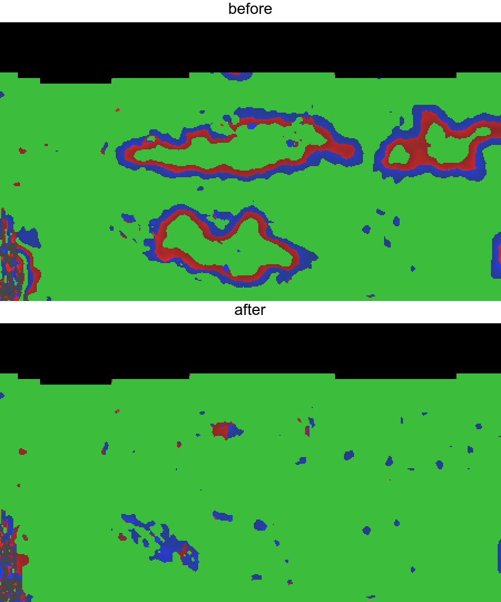
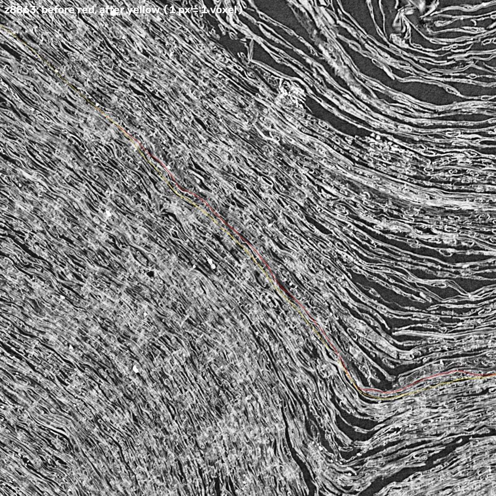
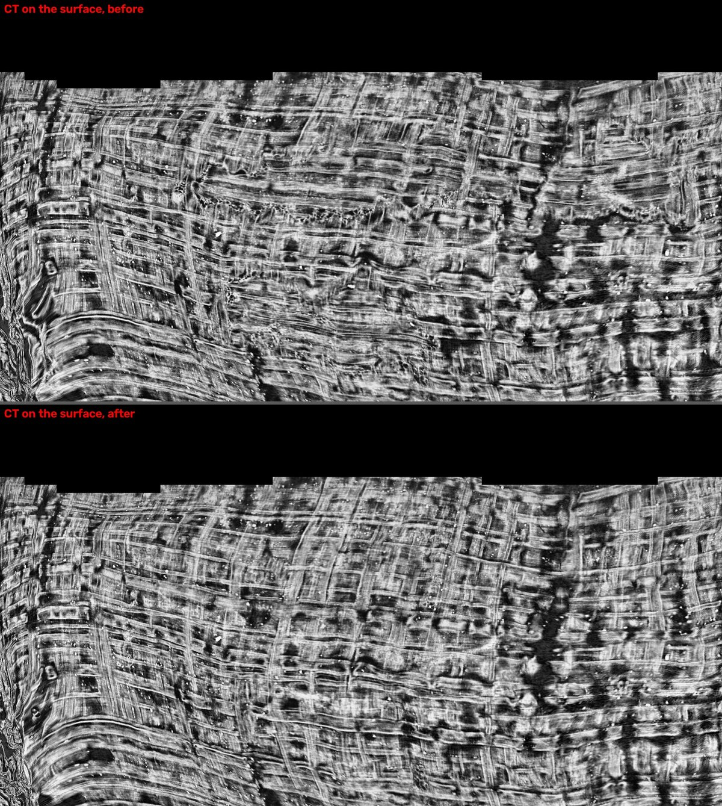
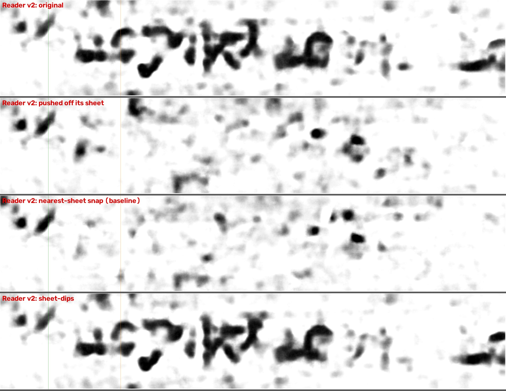
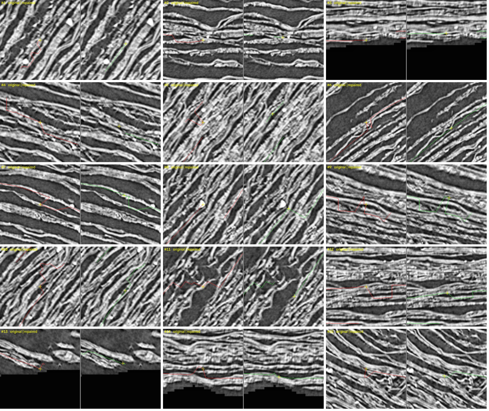
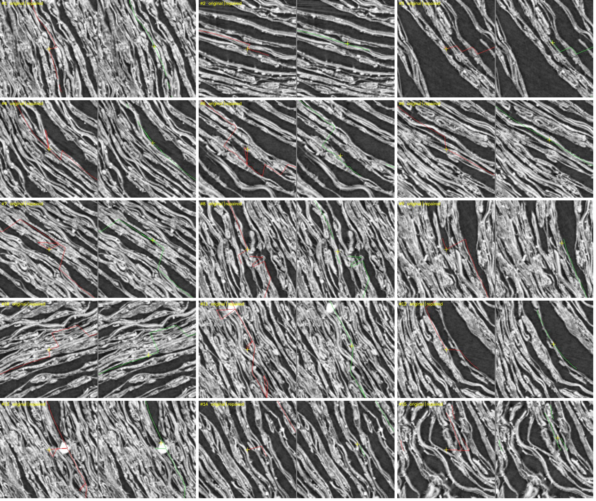

# sheet-dips: repair sheet switches in segmented scroll surfaces

Segmented surfaces of Herculaneum scrolls sometimes leave their sheet. Where neighbouring sheets touch or the
papyrus is crumpled, a patch of the surface moves onto the next sheet and comes back. The ink on that patch is lost
to ink detection: a surface 10-20 voxels off its sheet shows nothing.

`sheet-dips` finds these patches and moves the surface back onto its sheet. It starts from a trusted part of the
surface and follows the sheet layer through the rest by integrating local layer dips, as seismic interpreters pick a
horizon from a dip field (Lomask et al. 2006, Fomel 2010, Wu & Hale 2015).

- Input: any tifxyz surface (VC3D segments, spiral-fit windings, GrowPatch patches) and the scroll's public surface
  prediction.
- Output: a repaired tifxyz that VC3D can open and render.
- Runtime: about a minute for a 1 x 2 cm patch on a CPU.

It also audits **flattened atlases** (e.g. ScrollFiesta's): `scripts/seam_audit.py` lists every seam where two charts
from different wraps were placed side by side, and can move them back onto one sheet. On two public PHerc. 0139
atlases, 97 % of the seams it reports join different windings of the official segments. The repair closes 41-46 %
of them and is a small net gain over the whole atlas, including on an atlas held out from tuning (section 4). On a
second scroll, PHerc. Paris 4, with the same parameters, 98 % of the labelled seams join different windings of the
official winding field, and the repair makes 65 % of them agree (section 5).

## How it works

1. **On-sheet map.**
   - The surface prediction (`representations/predictions/surfaces/...-m7-...zarr`, a binary map of sheet surfaces)
     is sampled along the surface normals.
   - A cell is on-sheet where a predicted sheet line passes within ±1 voxel (`--tol`).
   - A patch that has switched to a neighbouring sheet shows up as an on-sheet *island* ringed by off-sheet cells.
   - The ±1 voxel test also fires where a surface runs a few voxels beside its predicted line, which is common with
     predictions of one sheet face (PHerc. 0139's recto prediction runs 1-3 voxels off the published segments; see
     section 3). The scanner therefore also reports *jump islands* (`offsheet.jump_islands`): neighbouring cells are
     taken to be on the same sheet while the offset of their nearest predicted line changes by at most 3 voxels; a
     switch shows as a jump of about half the sheet spacing where the surface passes between sheets.
2. **Anchor.** The largest connected on-sheet region more than 6 map cells (24 px) from any off-sheet cell. This
   cuts the thin bridges into the islands, so islands are not part of the anchor.
3. **Dips.**
   - The prediction is sampled along the normals: 81 layers, ±40 voxels.
   - In this volume the sheets are layers, and where the surface crosses them the layers dip.
   - Dips along both surface directions are measured by normalised cross-correlation of the normal profiles of
     columns 16 px apart, over ±3 voxels with sub-voxel refinement, aggregated over a Gaussian window.
4. **Integration.**
   - The offset field o(z, u) is the weighted least-squares solution of ∂o/∂z = p_z and ∂o/∂u = p_u, with o = 0 on
     the anchor. The weights are the correlation peaks.
   - It is solved directly with a sparse solver on a 2× coarser grid.
   - The whole field is solved at once, so one ambiguous spot is carried by its neighbours instead of sending
     everything after it off course, as a slice-by-slice tracer would.
5. The surface moves by o along its smoothed normals. Steps 3-5 are repeated (3 passes by default).

The dips are measured on the surface prediction, not on the CT. On CT, the papyrus fibre texture biased the dip
estimates by 20-85 % in our tests.

## Results on public data (PHerc. 0306B, 8.64 µm, volume 20250521133212)

### 1. Real sheet switches

The surface is winding w076 of a spiral fit of the band z 8784-10212 (`fit_spiral` from ScrollPrize/villa, snapped
onto the surface prediction), rows 0-1000 and columns 200-2000 of its canvas. The mesh is included in
`data/PHerc0306B_z8784-10212_w076.tifxyz`. It has three islands where it sits on a neighbouring sheet.

| | on-sheet | off-sheet (a sheet line within 20 vx, but not at the surface) |
|---|---|---|
| before | 81.5 % | 17.7 % |
| after 3 passes | **95.7 %** | **3.6 %** |



*Green: on-sheet. Red / blue: the nearest sheet line is in front of / behind the surface (brighter = farther).*

**Independent checks, CT only (`scripts/qa.py`):**

- In the cross-section at z 8863 through the largest island, the original surface (red) leaves for a neighbouring
  sheet 10-17 voxels away. The repaired one (yellow) stays on the sheet it follows over the anchored part.
  
- On the surface itself, the CT sampled on the repaired surface shows the papyrus fibre grid running continuously
  across the former islands. The original shows a ring of disturbed texture around each island.
  

### 2. Controlled test on a surface with known text (`scripts/synth_test.py`)

- The surface: the 306B First Letters winners' published region mesh
  ([SirProdigle/pherc0306b-first-letters](https://github.com/SirProdigle/pherc0306b-first-letters),
  `submission/mesh/PHerc0306B_20250521133212_w074own_touchup_V5Rc_region`), canvas rows 650-1450, columns 0-4200,
  which carries their text.
- It is pushed off its sheet: 0 over the first 400 px (the anchor), a smooth ramp to 24 voxels over 600 px, plus a
  ±6 voxel wobble. It is then repaired with the anchor on the untouched part.
- Baseline: the snapping step of current pipelines (e.g. villa's snap, or the `snap_meshes` step of published First Letters pipelines), i.e.
  each point moves to the nearest predicted sheet line along its normal (median-filtered).

| part | pushed off: distance to the original | nearest-sheet snap | sheet-dips | sheet-dips within 2 / 4 vx |
|---|---|---|---|---|
| ramp | 11.6 vx | 15.1 vx | **0.8 vx** | 84 % / 98 % |
| fully displaced | 24.0 vx | 24.1 vx | **1.9 vx** | 53 % / 90 % |

The four surfaces were rendered with VC3D's `vc_render_tifxyz` (65 layers) and Reader v2 and TRACE v3B were run on
the reading face. Correlation of each ink map with the original's, right of the ramp:

| model | pushed off | nearest-sheet snap | sheet-dips |
|---|---|---|---|
| Reader v2 | r = 0.04 | r = 0.04 | **r = 0.96** |
| TRACE v3B | r = 0.07 | r = 0.04 | **r = 0.96** |



*Reader v2; top to bottom: original, pushed off its sheet, nearest-sheet snap, sheet-dips. The green line marks the
end of the anchor and the orange line the end of the ramp. TRACE v3B: `docs/synth_text_trace.jpg`.*

The snap lands on whichever sheet is nearest, here a neighbouring one, and stays there; following the dips from the
anchor brings the surface back to its own sheet and the text with it.

**What this test does not show.** The displacement is ours. It shows that the repair can undo a switch of this size,
not that published segmentations lose text this way or that sheet-dips improves them. That needs real switches over
known text (section 3).

### 3. Survey of public segments (`scripts/scan_segments.py`)

We looked for real switches over known text in published segmentations: the 38 public PHerc. 0139 segments
(meshes on volume 20260102150214 x 0.25, recto prediction level 2), a Scroll 1 (PHercParis4) GP-era segment, and
the public whole-scroll spiral fit of Scroll 1 (`20260926044226-spiral-output-generation-19`, fitted in the frame
of the m7-L2 prediction) against a segment that covers the same papyrus (`20260623145652-w059-063`). The official
ink previews of each surface served as the reference.

- **The ±1 voxel on-sheet map over-reports.** On PHerc. 0139 it marked 8-35 % of the segments off-sheet and up to
  27 % as islands, but the official ink shows text running through many of these areas. Normal sections show why:
  the surface stays on its papyrus layer while the predicted recto line runs 1-3 voxels beside it, and smoothing the
  profiles across cells 40 voxels apart blurred the corrugated layers. A wider tolerance (±3) removes these false
  islands but also merges the tightly packed sheets of the real switch in section 1, so the scanner now reports
  jump islands (see "How it works").
- **No switch over text was found.** With jump islands, the PHerc. 0139 segments are 69-95 % one piece; the largest
  islands lie at segment edges or in dot fields with no legible text nearby, and the ink inside matches the ink
  around them. On the Scroll 1 GP-era segment the islands lie along the edges.
- **The whole-scroll spiral fit is on the right sheet where we compared it.** Its official ink shows less text in
  the lower halves of the columns than the overlapping segment's, and the local agreement of the two inks falls as
  the two surfaces diverge (correlation 0.30 where they are within 1.5 voxels, 0.17 at 3-5 voxels). But the two
  surfaces are 1.2 voxels apart in the median (level 2, 9.6 µm), and rendered with the same models (Hecate, TRACE)
  both show the same lines of text: the difference comes from the ink models, not from the geometry.
- **Repairing a good surface makes it worse.** On that spiral-fit crop, sheet-dips moved the surface 1.2 -> 1.9
  voxels away from the reference segment and on-sheet fell from 63 to 58 %; the nearest-sheet snap left it
  unchanged (1.3 voxels). Apply the repair only where the scanner finds jump islands.

### 4. Wrap switches at the seams of flattened atlases (ScrollFiesta, PHerc. 0139)

ScrollFiesta builds a flattened sheet of PHerc. 0139 from the binary recto prediction. Its public canonical atlases
(`output/canonical_best/pherc0139_*/atlas/atlas_bake.obj` in
[Hob3rMallow/scrollfiesta_public](https://github.com/Hob3rMallow/scrollfiesta_public)) are uv layouts of many mesh
charts. Because they mesh the prediction, the on-sheet tests of section 1 see almost nothing: 99.6 % of the 4x5x5
atlas is on a predicted sheet. Their errors are at the **seams**, where two charts that meet in uv come from
different wraps of the scroll. Across such a seam the surface steps by one or two sheet spacings (8-25 voxels).

`scripts/seam_audit.py` converts an atlas OBJ to a tifxyz grid (one node every 4 uv units, with a chart map), finds
every neighbour pair across a chart boundary that is offset along the normal by more than 4 voxels, and labels it:
- **switch**: offset <= 25 voxels and 3D gap <= 30 voxels, i.e. neighbours in the scroll on different sheets;
- **tear**: anything larger, i.e. uv neighbours that are not neighbours in the scroll.

With `--repair` it also moves the switched charts back onto their neighbours' sheet:
- One rigid offset per chart unit is chosen jointly for all units, by iterated conditional modes over the seam
  contacts.
- Each unit is then grown node by node from its seam, snapping to the predicted sheet line within 2.5 voxels.
- A unit stays where it is if fewer than 70 % of its nodes snap.
- A cleanup then flattens the right-angle detours the labelling leaves (`sheetdips/bumps.py`). A detour is a step of
  more than 4 voxels along a grid row or column, a flat run of at most 40 nodes and a step back to the first sheet.
  The labelling moves one unit at a time, so small units displaced together stay where they are: they agree with
  each other. The cleanup moves a seam-free piece of at most 300 nodes, then any detour left, as a whole by the
  offset its neighbours agree on (at least 60 % of its boundary steps within 3 voxels, no snapping), and keeps the
  move only if it removes at least half of those steps. `--no-cleanup` stops after the labelling.

**Independent check (`scripts/seam_check.py`).**
- The reference is the official PHerc. 0139 segments, registered to the same 9.362 µm volume; 33 reach the
  10x10x10 atlas and 37 the 4x21x21. They were grown on
  a different prediction and reviewed by people, and each is named after its winding.
- An atlas node counts as on a segment if it lies within 3 voxels of it.
- A pair is **continuous** if one segment holds both nodes within 12 voxels of each other.

The parameters were tuned on the 10x10x10 atlas. They were then frozen and run once on the 4x21x21 atlas, a larger
layout of the same scroll that played no part in tuning.

| | 10x10x10 (tuning) | 4x21x21 (held out) |
|---|---|---|
| grid nodes / charts on the grid (mesh components) | 2.7 M / 6 878 (159 752) | 5.3 M / 15 368 (184 360) |
| local seam pairs (switch class) | 22 817 | 60 898 |
| ... with both nodes on official segments | 9 230 | 20 779 |
| ... official winding differs by 1 / 2 / >= 3 / 0 | 79 / 16 / 2 / 3 % | 75 / 18 / 3 / 3.4 % |
| repair: broken switch pairs made continuous | 3 781 of 9 166 (41 %) | 9 468 of 20 695 (46 %) |
| repair: continuous switch pairs broken | 4 | 6 |
| control pairs across charts (offset <= 1 vx) broken by the repair | 377 of 18 657 (2.0 %) | 327 of 39 415 (0.8 %) |
| all neighbour pairs: continuous before -> after | 1 464 611 -> 1 465 540 | 5 332 346 -> 5 335 482 |
| moved nodes on an official segment, before -> after | 49 319 -> 48 328 | 107 201 -> 104 757 |
| right-angle detours along rows and columns: atlas -> labelling -> cleanup | 5 023 -> 1 998 -> 1 143 | 13 357 -> 6 030 -> 3 328 |
| run time (CPU, after conversion) | about 1 min | about 3 min |

The labelling alone (`--no-cleanup`, the first version of this tool) fixes 37 % / 40 %, breaks 2.1 % / 1.0 % of the
controls and adds +576 / +3 054 continuous pairs. The cleanup was added after a reader of the blind panels below
pointed out the detours on clean, well separated sheets; its parameters were set on 10x10x10 and run once on 4x21x21.

- **The detector is right about 97 % of the time.** Of the local seams it reports, 97 % (96.6 % held out) join two
  different windings of the official segments. Inside-chart control pairs share a winding 97-99 % of the time.
- **The repair is a small net gain.** It closes 41 % (46 % held out) of the switches the official segments can judge.
  It breaks 0.8-2 % of the across-chart controls; those are charts moved as a whole onto a wrong wrap. Over all
  neighbour pairs the number of continuous pairs rises, by +3 136 on the held-out atlas, and the right-angle detours
  drop by three quarters. The atlas is about 97 % right to begin with,
  so this is a cleanup, not a large repair.
- Earlier versions are worse. One rigid shift per piece, followed by a snap, broke 171 606 continuous pairs on
  10x10x10: a single offset cannot follow the varying sheet spacing, and pieces land between sheets.

**Blinded CT check (held-out 4x21x21).**
- Sample: 30 random moved units of at least 20 nodes. For each, the grid row through a border node is drawn on the
  CT slice, original and repaired side by side in random left/right order, both in the same colour.
- Raters: three independent model raters from two vendors, each of which saw only the panels: two Claude subagents
  (Claude Opus 5.5, 2026-11-14; at native resolution, six panels per image) and one Codex agent (GPT 6.2 Sol,
  2026-11-25; the same panels, with a written instruction, free to crop and zoom them). Each was asked which line
  stays on one sheet across the marked node.

| | Claude rater 1 | Claude rater 2 | Codex rater | all three agree |
|---|---|---|---|---|
| repaired stays on one sheet, original does not | 17 | 17 | 14 | 14 |
| original stays, repaired does not | 1 | 1 | 2 | 1 |
| neither stays | 6 | 5 | 7 | 5 |
| both stay, on different sheets / the same sheet | 2 / 1 | 3 / 0 | 3 / 1 | 2 / 0 |
| unclear | 3 | 4 | 3 | 1 |

- The two Claude raters agreed on 26 of 30 units, the Codex rater with each of them on 24, all three on 23. Every unit
  the Codex rater judged repaired-better was judged so by both Claude raters, and it judged none of their
  repaired-better units original-better (two of them it calls "neither").
- In two of the unclear units (#4, #21), the repaired line is not drawn near the node, because it moved off the CT
  slice; in both, the original steps onto another sheet there.
- The panels show the labelling-only repair. The cleanup added later changes the row near the marked node in 3 of the
  30 units: in #7 and #12 it removes a right-angle detour the labelling had left; in #22 the line changes but is
  not clearly better.
- A second round (2026-11-25, after the cleanup was added; the same three kinds of rater, each on its own copy of the
  panels and the same instruction) on two new random samples of the held-out atlas. Task A: 30 units the full
  repair moved, against the original. Task B: 30 units the cleanup moved, against the labelling-only repair.

| | A: Claude 1 | A: Claude 2 | A: Codex | A: all three | B: Claude 1 | B: Claude 2 | B: Codex | B: all three |
|---|---|---|---|---|---|---|---|---|
| repaired / cleaned line stays on one sheet, the other does not | 20 | 18 | 15 | 13 | 23 | 24 | 17 | 16 |
| the other line stays, the repaired / cleaned one does not | 3 | 2 | 1 | 1 | 0 | 1 | 0 | 0 |
| neither stays | 3 | 4 | 7 | 1 | 6 | 4 | 11 | 3 |
| both stay (different sheets / same sheet) | 1 / 1 | 3 / 0 | 1 / 1 | 1 / 0 | 0 / 0 | 0 / 0 | 0 / 0 | 0 / 0 |
| unclear | 2 | 3 | 5 | 2 | 1 | 1 | 2 | 0 |

  Pairwise agreement: A 20-23 of 30, B 21-25 of 30; all three agree on 18 (A) and 19 (B) units.

- An earlier, single-rater pass on downscaled panels of the 10x10x10 atlas gave 16 repaired better against
  1 original better.
- In the same 10x10x10 pass, the rater judged 26 of 30 random seams that the repair left untouched as real steps
  onto another sheet (3 not, 1 unclear), and 14 of 15 mixed-in across-chart controls (offset <= 1 vx) as continuous
  (1 unclear). The Codex rater, on the same 45 panels, judged 29 of the 30 seams real steps (1 not) and 14 of the
  15 controls continuous (1 step). So the remaining seams are real, and the repair leaves many of them: on
  10x10x10, 5 406 untouched switch pairs run along grid rows.



*The 30 rated units of the held-out atlas, unblinded: original (red, left) and repaired (green, right). Only row
nodes within 4 voxels of the CT slice are drawn; the yellow cross is the unit's border node. Panels 16-30:
`docs/sf0139_seam_xsec_2.jpg`.*

**What this section does not show.** The official ink sampled on the atlas is a patchwork of chart-sized blocks with
no legible letter. The repaired units are at most 3.7 mm across. So there is no case here of text made readable across
a repaired seam; the evidence is geometric (official windings and CT).

**Atlas versions.** The audited files are ScrollFiesta's canonical `atlas_bake.obj` of 10x10x10 and 4x21x21 (sha256
`56797148…` and `cdbb8f73…`, as in its `output/canonical_best/SHA256SUMS.txt`), committed once in 9ba2526f
(2026-07-31) and unchanged at the October 2026 head. ScrollFiesta's newer sheet assembler (September 2026) accepts a
seam only within 4 voxels RMS and leaves the rest unplaced (47 % coverage on its 4x5x5 check); its output is not
published and was not audited here. No newer whole-atlas output is published.

**Against ScrollFiesta's own audit.** ScrollFiesta's placement audit reports a whole-turn error per pair of adjacent
cubes: `turn_off` counts points of one surface whose winding phase differs by more than half a turn across the face.
It flags 5.5 % of its samples on 10x10x10 and 8.1 % on 4x21x21. The switch pairs found here are not concentrated on the
faces it flags. They fall there no more often than continuous control pairs across charts (10x10x10: 34 % against
36 %; 4x21x21: 45 % against 43 %), with the same mean `turn_off` fraction. Of the switch pairs, 17-24 % sit inside a
cube or on a face the audit never sampled, against about 1 % of the controls. The turn-off check asks whether one
surface gets one turn on both sides of a cube face. The seam audit asks whether two neighbours in uv lie on the same
wrap in 3D.

ScrollFiesta's atlas stage also counts, per group of charts, the uv overlaps between faces whose radii differ by at
least 0.75 of a wrap (`intra_wrongwind` in `groups.csv`). Groups with such counts cover 97 % of the 10x10x10 atlas and
99 % of the 4x21x21 atlas, so this flag marks nearly every switch pair and nearly every control pair alike (96 % against
98 %, and 99 % against 99 %). Weighted by the group's count per face, the switch pairs sit in groups with 1.6x and 1.3x
the controls' rate. Both diagnostics show that wrong winding exists, but neither shows where the 3D switches are. 91-96 %
of the switch pairs lie inside one group, where a rigid group shift cannot separate the two wraps.

**Related tools.** Tools that check one traced segment report suspects for review rather than confirmed switches,
and none repairs them:
- [sheet-ridge-audit](https://github.com/landonking0808/sheet-ridge-audit) compares a segment with a predicted sheet
  field;
- [windingguard](https://github.com/A-PC-I/windingguard) scores radial anomalies;
- [sheet-topo-bench](https://github.com/tonclap/sheet-topo-bench) benchmarks detectors on injected errors and advises
  against automatic cutting.

The seam audit works on a whole atlas of many charts, checks its findings against independent official segments, and
moves charts onto the right wrap instead of cutting them out. Its precision against the official windings is about
97 %; its CT check relies on model raters, as noted above.

### 5. A second scroll: PHerc. Paris 4 (own ScrollFiesta run)

Section 4 tuned the seam audit on one scroll. Here the same parameters run, frozen, on a second scroll: PHerc. Paris 4,
volume 20260411134726, level 2 (9.6 µm), with its public m7 surface prediction
(`PHercParis4/representations/predictions/surfaces/20260411134726-surface-20260413222639-surface-m7-L2-th0.2.zarr`).

**The atlas.** No flattened atlas of Paris 4 is published, so we built one with the public ScrollFiesta code
(commit 3c460779 of 2026-10-31), following its `docs/PIPELINE.md`:
- Crop: 4 x 21 x 21 cubes of 128 voxels (z 13056-13568, y 3072-5760, x 2944-5632; 1764 cubes, 71 M mesh faces).
- Wrap pitch pinned to 21.5 voxels, the radial spacing of the predicted sheets (`paris4/pred_pitch.py`). The automatic
  estimate gave 5.0, and the official reference played no part in this choice.
- Several ScrollFiesta tools hard-code the PHerc. 0139 umbilicus. Rather than patching them, `paris4/carve.py` writes
  the cubes under shifted names, so the Paris 4 axis falls on the hard-coded one; `paris4/unshift_tifxyz.py` moves
  the audited surfaces back.
- One build fix: on Linux the mesher was compiled without OpenMP (`paris4/cmake_omp.patch`). No algorithm was
  changed.
- Placement audit: whole-turn error 0.00 %, |du| < 10 voxels for 96 % of joins. ScrollFiesta's quality gate fails
  only on corr(u, phi) = 0.53. The same check also fails on PHerc. 0139's 4x5x5 test bed with this code.
- The atlas stage (`atlas_overlap_fix --rounds 7`) runs on 25 tiles of at most 5 x 5 x 4 cubes of the one global
  placement (`paris4/make_tiles.py`). The whole crop, 18x denser than ScrollFiesta's canonical 0139 atlas, does not fit
  in 31 GB. Seams between tiles are not audited.

**The reference.** The official spiral of Paris 4 publishes a winding field
(`PHercParis4/representations/spiral/20260411134726-spiral-dataset-20261019084150/winding_inference`): rays from the
umbilicus with their sheet crossings, and each crossing's winding (seed winding of the ray + crossing level). It is
automatic, from the official spiral fit and winding model, and has not been reviewed by people. It is independent of
ScrollFiesta and of this tool.

**The rule, written before the atlas existed** (`paris4/p4_score.py`):
- Each node of a seam pair gets a side label: the majority winding of the reference crossings near its own chart.
  The crossings must lie within 3 voxels of chart nodes, and the nodes within 24 voxels of the seam node. A label
  needs at least 3 such crossings and a share of at least 0.6.
- D is the share of labelled pairs whose two labels differ. It is computed for the switch pairs and for two controls:
  across-chart pairs offset by at most 1 voxel, and neighbouring pairs inside one chart. The second shares almost
  its whole label window, so it is near 0 by construction.
- The detector holds if D(switch) >= 0.8 and D(switch) >= D(across) + 0.5, with at least 1000 labelled switch pairs.

**The frozen rule gave too few labels.** It labelled 867 switch pairs, below the 1000-pair floor, although
D(switch) = 0.99 against 0.022 for the across controls. The reference is too thin for it:
- It has 100-330 crossings per 128-voxel cube, about 3 per 24-voxel disc of sheet.
- Far from the axis, its crossings sit on the predicted sheets barely more often than random points do
  (`paris4/ref_quality.py`, which uses the reference and the prediction only):

| distance from the umbilicus (voxels) | 300-600 | 600-900 | 900-1200 | > 1200 |
|---|---|---|---|---|
| crossings within 1 voxel of a predicted sheet | 59 % | 45 % | 36 % | 34 % |
| random points within 1 voxel of a predicted sheet | 26 % | 25 % | 28 % | 29 % |

**Amended rule.** It was chosen on the controls only and fixed before any switch pair was scored with it:
- Only the cubes where the crossings beat random points by at least 0.15 are used (560 of 1764 cubes, 117 592
  crossings; `paris4/ref_filter.py`).
- Window 48 voxels, tolerance 5 voxels (a quarter of the 21.5-voxel pitch); the bars are unchanged.
- A new control replaces the inside-chart one: same-chart pairs at least two windows apart, whose label windows do
  not overlap.
- Labelled pairs therefore come from the central third of the crop.

| 25 tiles, summed | frozen rule | amended rule |
|---|---|---|
| switch pairs found by the audit | 96 481 | 96 481 |
| ... labelled | 867 | 11 357 |
| ... windings differ (D) | 98.7 % | 97.9 % |
| ... differ by 1 / 2 / >= 3 | 82 / 14 / 3 % | 88 / 9 / 0.5 % |
| across-chart controls (offset <= 1 vx): labelled, D | 1 903, 2.2 % | 47 282, 0.80 % |
| inside-chart neighbour controls: labelled, D | 213 222, 0.30 % | 467 660, 0.02 % |
| same-chart controls, windows apart (amended rule only): labelled, D | - | 331 434, 1.03 % |

The tiles are uneven. Five central tiles (01_00, 01_01, 01_02, 02_01, 02_02) hold 87 % of the labelled switch pairs;
there D(switch) is 0.96-0.99 and the same-chart controls differ in at most 0.9 %. In outer tiles with few reliable
cubes the same-chart controls differ far more often (02_03 5.8 %, 03_02 23 %, 01_04 45 %, the last with no labelled
switch), which fits the weaker reference away from the axis. Among tiles with at least 50 labelled switch pairs,
D(switch) is lowest in 03_01 (0.82 of 137); one outer tile (02_04) has 7 labelled switch pairs, none of them
differing.

**Repair** (`seam_audit.py --repair` with the Paris 4 prediction, the 0139 parameters, scored with the amended rule;
`paris4/tile_repair.sh`):

| 25 tiles | pairs scored | labels made equal | labels made different |
|---|---|---|---|
| switch pairs | 10 356 | 6 694 (65 %) | 13 |
| across-chart controls | 47 191 | 5 | 383 (0.81 %) |
| all neighbour pairs touched by the repair* | 159 390 | 7 765 | 514 |

\* Grid-neighbour pairs with a node moved by more than 2 voxels (at most 80 000 sampled per tile). This metric was
added after the first repair numbers; it is not one of the pre-set bars. Over these pairs the count with equal labels
rises from 149 464 to 156 715. The labelling alone (`--no-cleanup`) makes 63 % of the switch pairs agree; the
cleanup halves the right-angle detours (6 488 -> 3 350) without breaking more controls.

- **The detector transfers.** On a second scroll, with a different prediction and an atlas built independently,
  98 % of the labelled seams it reports join two different windings of the official winding field. The across-chart
  controls differ in 0.8 %, the same-chart controls in 1.0 % (61 % of the differing same-chart pairs are in outer
  tiles).
- **The repair transfers.** It makes 65 % of the labelled switch pairs agree with the reference. On PHerc. 0139 it
  closed 41-46 %, but that is a different measure (both nodes on one official segment), so the two numbers are not
  directly comparable. It moves 0.8 % of the across-chart controls onto another winding.



*Fifteen random moved units of one central tile (02_01), drawn on the Paris 4 CT: original (red, left) and repaired
(green, right). Unblinded and not rated; an illustration, not evidence.*

**What this section does not show.**
- The atlas is our own run of ScrollFiesta's public code on a crop of Paris 4, not a ScrollFiesta result.
- The reference is an automatic winding field, not reviewed segments.
- The amended rule was written after the frozen rule fell short on coverage; both are reported.
- Only the central third of the crop can be scored.
- There is no blinded CT rating on Paris 4.

## Usage

```bash
pip install -r requirements.txt

# repair a surface (a crop of its canvas, in canvas px)
python scripts/sheet_fix.py SURFACE.tifxyz \
    PHerc0306B/representations/predictions/surfaces/20250521133212-surface-20260413222639-surface-m7-L0-th0.2.zarr/0 \
    out/ --rows 0 1000 --cols 200 2000
# -> out/surface.tifxyz, out/onsheet_before.png, out/onsheet_after.png, out/summary.json

# CT checks: surface images before / after and cross-sections
python scripts/qa.py SURFACE.tifxyz out/points3d.npy \
    PHerc0306B/volumes/20250521133212-8.640um-1.2m-116keV-masked.zarr/0 out/qa \
    --rows 0 1000 --cols 200 2000 --z 8863

# controlled test
python scripts/synth_test.py SURFACE.tifxyz PRED out_synth/ --rows 650 1450 --cols 0 4200 --anchor-cols 400

# survey many segments (open-data keys allowed); one sample per grid node, every 8th node of a 2.399 um mesh,
# against level 2 of its volume's prediction
python scripts/scan_segments.py PRED_LEVEL_DIR out_scan/ SEGMENT.tifxyz ... --every 8 --coord-scale 0.25 \
    --tol 1 --lateral-sigma 0
# -> out_scan/scan.json (on-sheet shares, islands, jump islands per segment) and per-segment maps

# audit a flattened atlas for wrap switches at its seams, and repair them
python scripts/seam_audit.py atlas_bake.obj out_atlas/ \
    --repair PHerc0139/representations/predictions/surfaces/20250728140407-surface-20260413222639-surface-m7-L0-th0.2.zarr/0
# -> out_atlas/surface.tifxyz (+ charts.tif), seams.csv (switch / tear per pair), seam_map.png, summary.json,
#    repaired.tifxyz

# check against reference segments of the same scroll and volume (winding in their names)
python scripts/seam_check.py 'segments/*/mesh/*-on-20250728140407-9.362um.tifxyz' \
    out_atlas/surface.tifxyz out_atlas/repaired.tifxyz check.json

# Paris 4 (section 5): carve cubes under shifted names, run ScrollFiesta (grid_pipeline --halo 13 --skip-weld,
# scroll_whole, then scroll_whole --reregister --audit --raw-component-gauge --auto-anchor, both with
# --axis-table paris4/axis_p4_21.csv --wrap-spacing 21.5),
# then tile, audit, repair and score
python paris4/carve.py g4_21 13056 13568 3072 5760 2944 5632 --shift 0 -1024 -1408
python paris4/wi_probe.py WI_DIR wi/crop.npz 13000 13624 3000 5832 2872 5704     # WI_DIR: winding_inference/ download
python paris4/ref_quality.py g4_21 wi/crop.npz wi/ref_quality.json
python paris4/ref_filter.py wi/ref_quality.json wi/crop.npz wi/crop_rel15.npz --min-gain 0.15
python paris4/make_tiles.py PLACED_DIR tiles/
SF_BUILD=SCROLLFIESTA/build TILE_TIMEOUT=0 paris4/tile_chain.sh tiles tile_02_01 g4_21/shift.json wi/crop.npz
paris4/tile_repair.sh tiles wi/crop_rel15.npz
python paris4/p4_summary.py tiles summary.json
```

- Arrays are read chunk by chunk from the public bucket (`https://data.aws.ash2txt.org/`, cached under
  `~/.cache/sheetdips/`) or from a local zarr v2 level directory.
- Only the chunks around the surface are fetched.

## Limits

- **No real case yet of text lost by a published segmentation and recovered by the repair.** Section 4 finds and
  repairs real wrap switches in published atlases (checked against the official segments and CT), but no readable
  text crosses the repaired seams there.
- **The ±1 voxel on-sheet map over-reports** on one-face predictions (section 3); use the jump islands.
- **Atlas seams: the repair closes 41-46 % of the switches and moves 0.8-2 % of correct charts onto a wrong wrap.**
  A seam whose target has no predicted line within 2.5 voxels is left alone; most of these are 6-9 voxel steps between
  plies of one wrap.
- **Where the atlas strings pieces of several wraps along one row, the repair cannot find one sheet.** In such
  stretches (e.g. 8 charts on 5 different sheets within 100 nodes of one row) neighbours disagree with each other,
  so neither the labelling nor the cleanup has a majority to follow, and the row stays jagged. This comes from how
  the atlas is assembled (small per-cube charts, each given its wrap on its own), not from the seams; regrowing the
  grid from its largest pieces (each node following its neighbours, snapped to the prediction) was tried and
  dragged correct pieces onto wrong sheets.
- **Atlas seams were tested on two scrolls** (PHerc. 0139 with its public atlases; PHerc. Paris 4 with our own
  ScrollFiesta run, scored against an automatic winding field in the central third of one crop). The thresholds
  (4 / 25 / 30 voxels, 2.5-voxel snap, 70 % snapped, cleanup pieces <= 300 nodes) were set on 0139 and not retuned
  for Paris 4.
- **Do not run the repair on surfaces without switches.** It follows the dips from the anchor and can move a good
  surface off its sheet (section 3).
- **The anchor must be on the right sheet.** The tool keeps the anchor in place and makes the rest consistent with
  it.
- **The surface prediction has to separate the sheets.** Where predicted sheet lines merge, as in tightly compressed
  regions, the dips are ambiguous there; the integration carries the solution across from the neighbourhood, but it
  cannot create evidence.
- **Moves larger than about ±10 voxels per pass need several passes.** The default of 3 recovered 24 voxels in the
  test.
- **Islands that touch the crop border have no anchored context on that side.** Crop generously.

## Files

- `sheetdips/io.py`: zarr v2 chunk access (local or HTTPS), tifxyz I/O, canvas resampling, normals and thick
  sampling.
- `sheetdips/offsheet.py`: on-sheet maps and jump islands.
- `sheetdips/dips.py`: dip estimation, least-squares integration and the anchor.
- `sheetdips/fix.py`: the repair loop, and the seam repairs for atlases (`seam_repair_icm`).
- `sheetdips/bumps.py`: the cleanup after the seam repair (right-angle detours; `scripts/seam_bumps.py` runs it alone).
- `sheetdips/retrace.py`: slice-by-slice re-tracing of grid rows (experimental).
- `scripts/sheet_fix.py`, `scripts/qa.py`, `scripts/synth_test.py`, `scripts/scan_segments.py`.
- `scripts/seam_audit.py`, `scripts/seam_check.py`, `scripts/obj_to_tifxyz.py`, `scripts/seam_fix.py`; `scripts/row_retrace.py` and
  `scripts/merge_local.py` (experimental, not used in section 4).
- `paris4/`: the Paris 4 run of section 5 (cube carving, tiling, frame shift, reference download check and quality
  map, scoring, pooling, per-tile driver, build patch, axis table).

## Licence

MIT (see LICENSE). The data are the Vesuvius Challenge open data (CC BY-NC 4.0).
